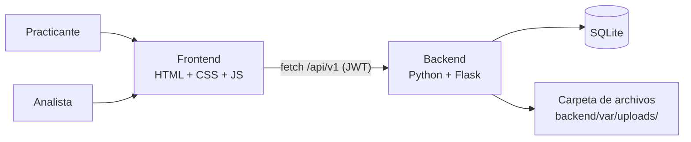

# Plataforma Básica de Selección de Practicantes

**Herramienta web para que los practicantes registren sus datos y su hoja de vida, y para que los analistas de selección los revisen y los marquen como «Viable» o «No viable».**


> Reto técnico *Kata Practicing – Challenge 1*, Vicepresidencia de Tecnología. Se ejecuta en local con un solo comando.

---

## Tabla de contenido

- [Funcionalidades](#funcionalidades)
- [Arquitectura](#arquitectura)
- [Tecnologías](#tecnologías)
- [Estructura del repositorio](#estructura-del-repositorio)
- [Requisitos](#requisitos)
- [Instalación y ejecución](#instalación-y-ejecución)
- [Configuración](#configuración)
- [Pruebas](#pruebas)
- [Capturas de pantalla](#capturas-de-pantalla)
- [Cómo contribuir](#cómo-contribuir)
- [Seguridad](#seguridad)

---

## Funcionalidades

**Lo que pide el reto**

- Formulario de registro con nombre completo, correo, carrera, semestre y hoja de vida en PDF, con validación de campos obligatorios en JavaScript.
- Panel del analista con la lista de practicantes, la información de cada uno y los botones «Viable» y «No viable».
- API para guardar, consultar y actualizar el estado; base SQLite local; archivos en una carpeta del servidor.
- **Opcional 1:** acceso al panel con usuario y contraseña.
- **Opcional 2:** descarga de la hoja de vida desde el panel.

**Lo que se agregó**

- Universidad, celular y aceptación del tratamiento de datos personales (Ley 1581 de 2012).
- Las mismas validaciones en el navegador y en el servidor, con los mismos mensajes; el servidor revisa que el PDF sea un PDF real.
- Filtro del panel por estado, con la cantidad de cada uno, y observación opcional en cada decisión.
- Datos de demostración, pruebas automatizadas de la API y del navegador, e integración continua.

Los requerimientos completos, con historias de usuario y casos de prueba, están en [`specs/`](specs/README.md).

## Arquitectura



Flask sirve las páginas y la API en el mismo origen (`http://localhost:5000`), así que no hace falta CORS.

**API** (prefijo `/api/v1`)

| Método | Ruta | Uso | Sesión |
|---|---|---|---|
| POST | `/interns` | Registrar practicante con su hoja de vida (`multipart/form-data`) | No |
| GET | `/interns?status=` | Listar practicantes, con filtro opcional por estado | Sí |
| GET | `/interns/summary` | Cantidad por estado | Sí |
| GET | `/interns/{id}` | Ver detalle | Sí |
| PATCH | `/interns/{id}/status` | Marcar `VIABLE` o `NOT_VIABLE`, con observación opcional | Sí |
| GET | `/interns/{id}/cv` | Descargar la hoja de vida | Sí |
| POST | `/auth/login` | Iniciar sesión del analista | No |

## Tecnologías

| Capa | Tecnología |
|---|---|
| Frontend | HTML, CSS y JavaScript puro (sin framework ni compilación) |
| Backend | Python 3.12, Flask 3.1 |
| Sesión | JWT con PyJWT; contraseña del analista con hash (Werkzeug) |
| Base de datos | SQLite con `sqlite3` y migraciones numeradas propias |
| Configuración | `.env` con python-dotenv |
| Pruebas | pytest (API) y Playwright (navegador) |
| Integración continua | GitHub Actions |

## Estructura del repositorio

El código va en inglés; la interfaz y la documentación, en español.

```
intern-selection-kata/
├── .github/                 # CI y plantilla de PR
├── backend/
│   ├── app/                 # aplicación Flask
│   ├── migrations/          # 001_create_interns.sql, ...
│   ├── tests/               # pytest
│   ├── requirements.txt
│   └── requirements-dev.txt
├── frontend/
│   ├── index.html           # registro del practicante
│   ├── css/styles.css
│   └── js/
├── specs/                   # requerimientos
├── .env.example
├── CLAUDE.md                # contexto del proyecto y reglas para agentes de IA
└── README.md
```

## Requisitos

- **Python 3.12** o más reciente
- **Git**

No hace falta instalar ninguna base de datos: SQLite es un archivo que el backend crea al arrancar.

## Instalación y ejecución

Desde la raíz del repositorio:

```bash
# 1. Configuración, solo la primera vez: copiar y completar ANALYST_PASSWORD y JWT_SECRET
cp .env.example .env            # en Windows: copy .env.example .env

# 2. Entorno virtual y dependencias
cd backend
python -m venv .venv
.venv\Scripts\activate          # en macOS/Linux: source .venv/bin/activate
pip install -r requirements.txt

# 3. Ejecutar (crea la base y aplica las migraciones al arrancar)
python -m flask --app app run
```

Abre <http://localhost:5000>.

## Configuración

Toda la configuración va en el `.env` de la raíz, que está en `.gitignore` y nunca se sube.

| Variable | Descripción | Ejemplo |
|---|---|---|
| `DB_PATH` | Archivo de la base SQLite (relativo a `backend/`) | `./var/data/intern-selection.db` |
| `UPLOAD_DIR` | Carpeta donde se guardan las hojas de vida | `./var/uploads` |
| `MAX_CV_SIZE_MB` | Tamaño máximo de la hoja de vida | `5` |
| `ANALYST_USERNAME` / `ANALYST_PASSWORD` | Credenciales del analista | `analista` / — |
| `JWT_SECRET` | Clave para firmar las sesiones, de al menos 32 caracteres | — |
| `JWT_TTL_HOURS` | Duración de la sesión | `8` |
| `DEMO_DATA` | `true` carga 4 practicantes ficticios si la base está vacía | `true` |

## Pruebas

```bash
cd backend
pip install -r requirements-dev.txt
python -m pytest
```

Los casos de prueba (CP-01 a CP-25) y su trazabilidad con los requerimientos están en [`specs/requerimientos.md`](specs/requerimientos.md#10-casos-de-prueba-y-trazabilidad).

## Capturas de pantalla

*Se agregan al terminar la implementación.*

## Cómo contribuir

El repositorio sigue **GitHub Flow**: `main` siempre funciona y cada cambio entra por pull request.

1. Crea una rama desde `main` con el formato `<tipo>/<descripción-corta>`, en inglés y minúsculas: `feat/intern-form`.
2. Abre un pull request hacia `main`. El título es un [Conventional Commit](https://www.conventionalcommits.org/es/v1.0.0/) en inglés, por ejemplo `feat(api): add interns endpoints`, y la descripción va en español.
3. Se integra con *Squash and merge* cuando **CI Gate** y **PR Validation** están en verde.

## Seguridad

- **Nunca** subas credenciales, archivos `.env`, bases de datos ni hojas de vida al repositorio.
- Solo se aceptan archivos PDF reales, y el servidor genera el nombre con el que se guardan.
