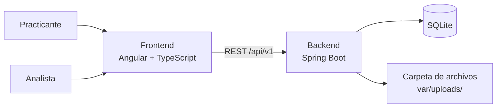

# Plataforma Básica de Selección de Practicantes

**Herramienta web para que los practicantes registren sus datos y su hoja de vida, y para que los analistas de selección los revisen y los marquen como «Viable» o «No viable».**


> Reto técnico *Kata Practicing – Challenge 1*, Vicepresidencia de Tecnología. Se ejecuta en local.

---

## Tabla de contenido

- [Funcionalidades](#funcionalidades)
- [Arquitectura](#arquitectura)
- [Tecnologías](#tecnologías)
- [Estructura del repositorio](#estructura-del-repositorio)
- [Requisitos](#requisitos)
- [Configuración](#configuración)
- [Ejecución en local](#ejecución-en-local)
- [Pruebas](#pruebas)
- [Capturas de pantalla](#capturas-de-pantalla)
- [Cómo contribuir](#cómo-contribuir)
- [Seguridad](#seguridad)

---

## Funcionalidades

### Formulario del practicante
- Registro de nombre completo, correo electrónico, carrera universitaria y semestre actual.
- Carga de la hoja de vida en PDF (máximo 5 MB).
- Validación de campos obligatorios y de formato, en el navegador y en el servidor.

### Panel del analista
- Lista de practicantes registrados con su estado: Pendiente, Viable o No viable.
- Detalle de cada practicante.
- Botones «Viable» y «No viable».
- Descarga de la hoja de vida.
- Acceso con usuario y contraseña.

Los requerimientos completos, con historias de usuario y casos de prueba, están en [`specs/`](specs/README.md).

## Arquitectura



**API** (prefijo `/api/v1`)

| Método | Ruta | Uso |
|---|---|---|
| POST | `/interns` | Registrar practicante con su hoja de vida (`multipart/form-data`) |
| GET | `/interns` | Listar practicantes |
| GET | `/interns/{id}` | Ver detalle |
| PATCH | `/interns/{id}/status` | Cambiar el estado a `VIABLE` o `NOT_VIABLE` |
| GET | `/interns/{id}/cv` | Descargar la hoja de vida |
| POST | `/auth/login` | Iniciar sesión del analista |

## Tecnologías

| Capa | Tecnología |
|---|---|
| Frontend | Angular 22, TypeScript, Angular CLI y Angular Router |
| Backend | Java 21 (LTS), Spring Boot 4.1, Spring Data JPA, Bean Validation |
| Base de datos | SQLite, con migraciones en Flyway |
| Node.js | 24 (LTS), fijado en `frontend/.nvmrc` |
| Pruebas | JUnit 5 y MockMvc (backend); Vitest (frontend) |
| Integración continua | GitHub Actions |

## Estructura del repositorio

El código va en inglés; la interfaz y la documentación, en español.

```
intern-selection-kata/
├── .github/                 # CI y plantilla de PR
├── backend/                 # Spring Boot (Maven)
│   ├── src/main/java/...
│   ├── src/main/resources/
│   │   ├── application.yml
│   │   └── db/migration/    # scripts de Flyway
│   └── pom.xml
├── frontend/                # Angular + TypeScript
│   ├── src/app/
│   │   ├── core/            # servicios transversales: API, sesión
│   │   └── features/        # formulario, panel, login
│   ├── proxy.conf.json      # en desarrollo, /api va al backend
│   └── package.json
├── docs/screenshots/        # capturas para este README
├── specs/                   # requerimientos
├── .env.example
├── CLAUDE.md                # contexto del proyecto y reglas para agentes de IA
└── README.md
```

## Requisitos

- **Java 21** (JDK)
- **Node.js 24** (LTS), con npm
- **Git**

No hace falta instalar ninguna base de datos: SQLite es un archivo que el backend crea al arrancar.

## Configuración

Copia `.env.example` a `.env` y completa los valores. El archivo `.env` está en `.gitignore` y nunca debe subirse.

| Variable | Descripción | Ejemplo |
|---|---|---|
| `DB_PATH` | Archivo de la base SQLite | `./var/data/intern-selection.db` |
| `UPLOAD_DIR` | Carpeta donde se guardan las hojas de vida | `./var/uploads` |
| `MAX_CV_SIZE_MB` | Tamaño máximo de la hoja de vida | `5` |
| `ANALYST_USERNAME` / `ANALYST_PASSWORD` | Credenciales del analista | `analista` / — |
| `JWT_SECRET` | Clave para firmar las sesiones, de al menos 32 caracteres | — |
| `SERVER_PORT` | Puerto del backend | `8080` |

## Ejecución en local

Desde la raíz del repositorio, cada parte en su propia terminal:

```bash
# 0. Configuración, solo la primera vez
cp .env.example .env

# 1. Backend (crea la base SQLite y aplica las migraciones al arrancar)
cd backend
./mvnw spring-boot:run

# 2. Frontend, en otra terminal
cd frontend
npm ci
npm start
```

- Formulario del practicante: <http://localhost:4200>
- Panel del analista: <http://localhost:4200/panel>
- API: <http://localhost:8080/api/v1>

## Pruebas

```bash
# Backend
(cd backend && ./mvnw verify)

# Frontend
(cd frontend && npm test)
```

Los casos de prueba (CP-01 a CP-16) y su trazabilidad con los requerimientos están en [`specs/requerimientos.md`](specs/requerimientos.md#6-casos-de-prueba-y-trazabilidad).

## Capturas de pantalla

*Se agregan al terminar la implementación, en `docs/screenshots/`.*

## Cómo contribuir

El repositorio sigue **GitHub Flow**: `main` siempre funciona y cada cambio entra por pull request.

1. Crea una rama desde `main` con el formato `<tipo>/<descripción-corta>`, en inglés y minúsculas: `feat/intern-form`.
2. Abre un pull request hacia `main`. El título es un [Conventional Commit](https://www.conventionalcommits.org/es/v1.0.0/) en inglés, por ejemplo `feat(form): add intern registration form`, y la descripción va en español.
3. Se integra con *Squash and merge* cuando **CI Gate** y **PR Validation** están en verde.

## Seguridad

- **Nunca** subas credenciales, archivos `.env`, bases de datos ni hojas de vida al repositorio.
- Solo se aceptan archivos PDF, y el servidor genera el nombre con el que se guardan.
